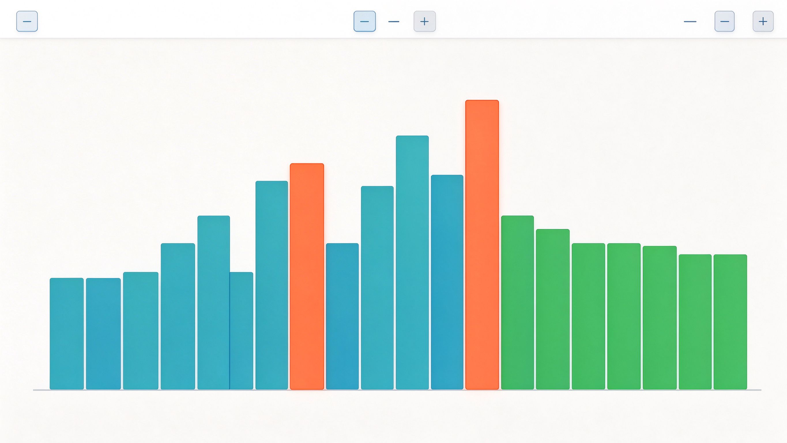

# 项目需求与设计文档（Project Requirements and Design）

> 项目名称：**经典排序算法可视化演示器（Sort Visualizer）**
> 文档版本：v1.0（初稿，待选题审核）
> 开发模式：Vibe Coding（AI 辅助编程）+ Git 分布式团队协作

---

## 一、项目概述

### 1.1 项目背景

随着大语言模型的爆发，**Vibe Coding（氛围编程）**正在重塑软件开发范式。本项目以小组协作方式，利用 AI 编程助手与 Git 版本控制工具，开发一个轻量级的**计算机基础概念可视化程序**，把抽象的排序算法过程以直观、动态的方式呈现出来。

### 1.2 项目目标

- 动态、直观地演示多种经典排序算法的**完整执行过程**，帮助理解比较、交换与算法效率。
- 体验现代软件工程的标准流程：**需求文档 → 分支协作 → AI 辅助编码 → 代码集成 → 开源交付**。
- 锻炼 Markdown 文档编写、Git 版本控制、提示词工程与代码审查能力。

### 1.3 选题意义

排序算法是《计算机科学基础》课程的核心知识点。单纯阅读代码难以理解其运行机理，而**柱状图动画 + 颜色标记 + 实时统计**能够清晰展示每一次比较与交换，使算法的时间复杂度差异"看得见"。

---
## 二、选题与核心概念

### 2.1 演示的算法

本项目计划实现以下 **4 种经典排序算法**：

1. **冒泡排序（Bubble Sort）**
2. **选择排序（Selection Sort）**
3. **插入排序（Insertion Sort）**
4. **快速排序（Quick Sort）**

### 2.2 涉及的核心概念

- **比较（Comparison）**：两个元素之间的大小比较。
- **交换（Swap）**：两个元素位置的互换。
- **有序区与无序区**：算法推进过程中已排序与未排序的部分。
- **时间复杂度**：各算法在最好、平均、最坏情况下的复杂度对比。
- **稳定性**：相等元素在排序后是否保持原有相对顺序。

### 2.3 各算法复杂度参考

| 算法 | 最好时间 | 平均时间 | 最坏时间 | 空间复杂度 | 稳定性 |
|---|---|---|---|---|---|
| 冒泡排序 | O(n) | O(n) | O(n²) | O(1) | 稳定 |
| 选择排序 | O(n²) | O(n²) | O(n²) | O(1) | 不稳定 |
| 插入排序 | O(n) | O(n²) | O(n²) | O(1) | 稳定 |
| 快速排序 | O(n log n) | O(n log n) | O(n²) | O(log n) | 不稳定 |

---
## 三、功能需求

### 3.1 数据生成

- 支持**随机生成**指定数量（如 5～100）的待排序数据。
- 支持**近似有序（nearly sorted）**等特殊数据，用于观察不同算法的最好/最坏情况。
- 支持**重置**数据与**新建**数组。

### 3.2 算法选择

- 提供下拉菜单或按钮，在冒泡、选择、插入、快速排序之间切换。
- 界面同步显示当前算法的**复杂度信息与原理简介**。

### 3.3 播放控制

- **开始 / 暂停 / 继续**：控制动画播放。
- **单步执行（Step）**：逐次执行一次比较或交换，便于教学讲解。
- **速度调节**：通过滑块调整动画延迟（快/中/慢）。
- **重置**：恢复到初始未排序状态。

### 3.4 可视化呈现

- 以**柱状图**表示数组，柱高对应数值大小。
- 用**不同颜色**标记元素状态，例如：
  - 正在**比较**的元素
  - 正在**交换**的元素
  - 已归入**有序区**的元素
  - 基准元素（快速排序的 pivot）
- 实时显示**比较次数**与**交换次数**统计。

### 3.5 信息展示

- 显示当前算法名称、时间/空间复杂度、稳定性。
- 显示当前执行步骤的文字说明（如"比较下标 3 与下标 4 的元素"）。

---
## 四、非功能需求

- **模块化**：UI、算法、动画控制、事件响应相互分离，便于多人并行开发与 Git 分工。
- **可维护性**：代码包含**详细中文注释**，结构清晰、命名规范。
- **易用性**：界面交互友好，无需命令行参数即可操作，适合课堂演示。
- **健壮性**：对空数据、极端数量等情况做容错处理，运行无明显 Bug。
- **可移植性**：基于标准库实现，不依赖额外第三方包，开箱即运行。

---
## 五、系统架构与模块设计

### 5.1 模块划分

系统采用分层、模块化设计，共划分为 4 个核心模块：

1. **UI 界面模块（ui）**：负责窗口、柱状图绘制、按钮与控制面板布局。
2. **核心算法模块（algorithms）**：实现各排序算法，以**生成器（generator）**逐步产出比较/交换动作。
3. **动画控制模块（animator）**：调度算法生成的动作序列，控制播放、暂停、单步与速度。
4. **事件响应模块（events）**：处理按钮点击、滑块、下拉选择等用户交互。

### 5.2 模块关系

```
用户操作
  |
  v
事件响应模块 (events)
  |
  v
动画控制模块 (animator) --> 核心算法模块 (algorithms)
  |                              |
  v                              v
UI 界面模块 (ui) <-------- 动作/状态数据
```

### 5.3 关键设计：生成器驱动的逐步动画

排序算法使用 Python 的 yield 关键字在每次比较或交换处"暂停"，把当前动作（类型、下标、数组快照）交给动画控制模块渲染，从而实现**暂停、单步与调速**，同时保证算法逻辑与界面逻辑解耦。

---
## 六、界面设计

### 6.1 主窗口布局（约 900×650）

- **顶部控制区**：算法选择下拉框、随机生成、开始、暂停、单步、重置按钮、速度与数量滑块。
- **中部可视化区**：柱状图动画画布，占窗口主要面积。
- **右侧/底部信息区**：算法名称、复杂度、稳定性、比较与交换次数、当前步骤说明。

### 6.2 参考示意图

> **说明：此处为参考图片占位，后续将替换为程序实际运行界面截图或设计原型图。**



---
## 七、技术选型

| 项目 | 选型 | 说明 |
|---|---|---|
| 开发语言 | **Python 3** | 语法简洁，适合快速开发与 AI 辅助生成 |
| GUI 框架 | **Tkinter** | Python 标准库自带，无需额外安装，跨平台 |
| 画布绘制 | **Canvas** | Tkinter 内置画布组件，用于绘制柱状图 |
| 版本控制 | **Git + GitHub** | 分支隔离、Pull Request、冲突解决 |
| AI 编程助手 | 大模型 / IDE 插件 | 提示词驱动生成代码并多轮调试 |

运行方式：

```bash
python main.py
```

---
## 八、团队分工

> **说明：下表为按角色的初步分工，待成员信息确认后替换为真实姓名与 GitHub 用户名。**

| 角色 | 负责模块 | 主要职责 | 成员 |
|---|---|---|---|
| 组长 / 项目负责人 | 集成与协作 | 仓库管理、代码审查、PR 合并、进度协调 | 待补充 |
| UI 工程师 | ui 模块 | 窗口布局、柱状图绘制、控制面板 | 待补充 |
| 算法工程师 | algorithms 模块 | 四种排序算法生成器实现 | 待补充 |
| 动画工程师 | animator 模块 | 动作调度、播放控制、速度调节 | 待补充 |
| 交互 / 文档工程师 | events 模块 + 文档 | 事件响应、需求文档与 README 维护 | 待补充 |

---
## 九、开发计划与里程碑

1. **第 1 阶段**：仓库初始化、需求文档协作与选题审核。
2. **第 2 阶段**：AI 辅助完成核心算法模块与 UI 模块开发。
3. **第 3 阶段**：动画与事件模块集成，人为制造并解决一次合并冲突。
4. **第 4 阶段**：完善 README、补充运行截图、课堂演示与开源交付。

---

## 十、参考资料

- 《计算机科学基础》课程讲义
- Tkinter 官方文档：https://docs.python.org/3/library/tkinter.html
- 排序算法维基百科：https://en.wikipedia.org/wiki/Sorting_algorithm

---

> **审核修改记录**：本栏目用于记录选题审核阶段教师的修改意见与响应，待审核后补充。